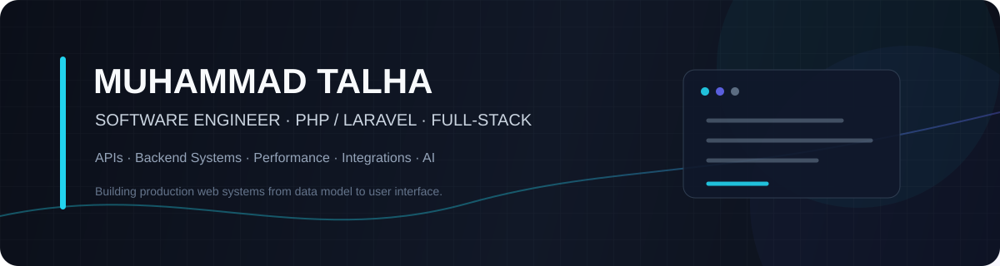

  

  
  
  

  <strong>Backend-focused Full-Stack Software Engineer</strong> 
  PHP · Laravel · APIs · React / Next.js · Production Engineering

I build and improve production web applications, with a focus on backend architecture, reliable APIs, data performance, integrations, and clean full-stack delivery.

## Selected Work

### 🛒 Mallshark — Multi-vendor e-commerce
Production Laravel engineering across products, orders, payments, payouts, shipping, analytics, marketplace operations, and search.

- **API performance:** improved product-detail response time from ~6s to ~1.5s in a system with ~6,000 products and 1,000+ users.
- **Search migration:** moved from Algolia to self-hosted Meilisearch, reducing search response time from ~3–4s to ~2–2.5s and saving approximately $100/month.
- **Stack:** PHP · Laravel · MySQL · Meilisearch · REST APIs
- *Production work · Private repository*

### 📅 [Smart Timetable](https://github.com/imiantalha/timetable) — Scheduling platform
Full-stack platform for creating, validating, editing, and publishing university timetables.

- Models teachers, rooms, sections, courses, and time slots as scheduling resources.
- Includes conflict validation, generated drafts, drag-and-drop editing, and persistent scheduling changes.
- **Stack:** Laravel · Next.js · PostgreSQL · Redis

### 🤖 [Blossom Glimmer API](https://github.com/imiantalha/blossom-glimmer-api) — AI-enabled application
Laravel application with conversational AI functionality and modular backend architecture.

- Implemented an AI chatbot using the Laravel AI SDK.
- Built authentication, role-based access control, policies, service/repository layers, and queued workflows.
- **Stack:** Laravel 12 · PHP · Laravel AI SDK · MongoDB

### 📝 [Weblogr](https://github.com/imiantalha/weblogr) — Core PHP blogging platform
A PHP/MySQL application covering authentication, publishing, moderation, social interactions, notifications, and Google identity integration.

- Security features include CSRF protection, login throttling, secure sessions, upload validation, and context-aware output escaping.
- Includes layered request-to-database architecture and GitHub Actions syntax validation.
- **Stack:** PHP · MySQL · OAuth 2.0 · OIDC · PKCE
- [Live demo](https://weblogr.up.railway.app/)

## Engineering Focus

- **Backend:** PHP, Laravel, REST API design, Eloquent, MVC, OOP, SOLID, authentication, RBAC, policies
- **Data:** MySQL, PostgreSQL, SQL Server, MongoDB, Redis, indexing, query optimization, caching
- **Async & integrations:** queues, jobs, scheduled tasks, webhooks, payments, shipping, search, notifications
- **Frontend:** React, Next.js, TypeScript, JavaScript, Blade, Vite
- **Delivery:** Docker, Nginx, Linux, PHPUnit, Postman, code review, CI/CD, debugging

## Experience

**Software Engineer · MindBlaze Technologies**  
Sep 10, 2024 — Present

## GitHub Activity

  
  

  

---

  <strong>Let's build something useful.</strong> 
  <a href="https://imiantalha.vercel.app/">Portfolio</a> ·
  <a href="https://www.linkedin.com/in/imiantalha/">LinkedIn</a> ·
  <a href="https://github.com/imiantalha">GitHub</a>

