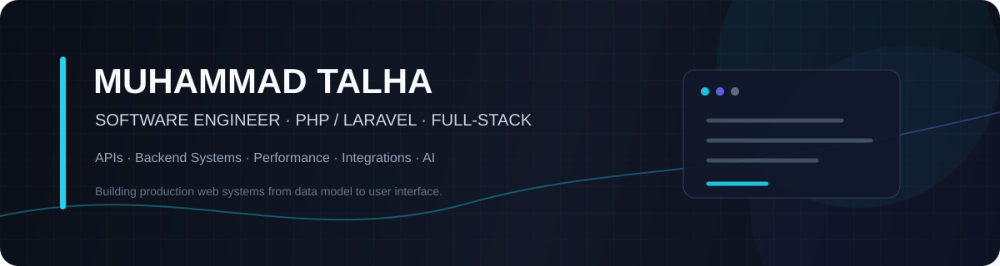

  

  
  
  

  <strong>Backend Engineer · Laravel &amp; PHP</strong> 
  Payments · Shipping · Search · Versioned APIs for marketplaces

I'm Muhammad Talha, a backend engineer in Lahore, Pakistan. I build the parts of marketplaces that have to work every time: checkout and payments, shipping, search, and the APIs that mobile apps depend on.

🟢 **Open to backend / full-stack Laravel roles** — remote (UTC+5) or on-site/hybrid in Lahore.

## What I've shipped in production

Software Engineer at **MindBlaze Technologies** since Sep 2024, including **Mallshark**, a multi-vendor marketplace with **1M+ users, 200+ vendors and 6K+ products** across Middle East warehouses:

- **Faster product pages:** cut a product-detail API from **~6s to ~1.5s** by profiling queries, adding indexes, eager loading and trimming payloads.
- **Search, rebuilt:** moved from Algolia to self-hosted Meilisearch, taking search responses from **~3–4s to ~2–2.5s** and saving **~$100/month**.
- **Payments:** Stripe, PayPal and Crypto.com with signature-verified, idempotent webhook handling.
- **Shipping:** FedEx, USPS and ShipStation for rates, labels and tracking.
- **API versioning:** v1–v3, so older mobile app releases keep working while new contracts evolve.
- **Two databases, one workflow:** MySQL plus an external SQL Server for stock and customer-specific pricing.

Client code is private — the [case studies](https://imiantalha.vercel.app/projects) explain the problems and the decisions.

## Code you can read

| Project | What it shows | Stack |
|---|---|---|
| [**Smart Timetable**](https://github.com/imiantalha/timetable) | University timetable planner: queued generation with schedule scoring, conflict detection for teacher, room and section clashes, and a Next.js drag-and-drop builder | Laravel 13 · Next.js 16 · TypeScript |
| [**Attendance Management System**](https://github.com/imiantalha/attendance-management-system) | FormRequest → Service → API Resource layering, Sanctum API v1, RBAC with policies, PHPUnit tests and GitHub Actions CI | Laravel · MySQL |
| [**Blossom Glimmer API**](https://github.com/imiantalha/blossom-glimmer-api) | AI chatbot built with the Laravel AI SDK, plus auth, roles and permissions, policies and queued workflows | Laravel 12 · MongoDB |
| [**Weblogr**](https://github.com/imiantalha/weblogr) · [live demo](https://weblogr.up.railway.app/) | Auth written from scratch: Google OAuth 2.0 / OIDC with PKCE, CSRF protection, login throttling, secure sessions | PHP · MySQL |

## Toolbox

- **Backend:** PHP, Laravel, REST API design, Sanctum / Passport, RBAC, queues & jobs, webhooks
- **Data:** MySQL, SQL Server, PostgreSQL, MongoDB, Redis, Meilisearch, query optimization
- **Frontend:** React, Next.js, TypeScript, Blade
- **Quality & delivery:** PHPUnit, Pint, GitHub Actions, Docker, Nginx, Vercel

---

  <strong>Hiring for a Laravel backend role?</strong> I reply within a day. 
  <a href="mailto:muhammadtalha.codes@gmail.com">Email</a> ·
  <a href="https://www.linkedin.com/in/imiantalha/">LinkedIn</a> ·
  <a href="https://imiantalha.vercel.app/">Portfolio</a>

